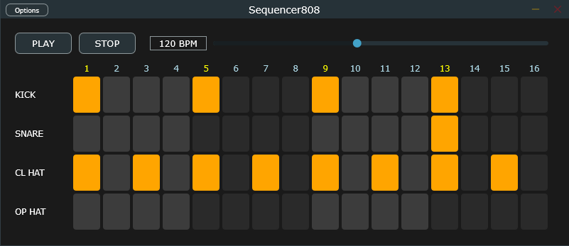

# Sequencer808

A 16-step, 4-track drum machine inspired by the
Roland TR-808, built with C++ and JUCE.

## Features

- 16-step grid for Kick, Snare, Closed Hi-Hat
  and Open Hi-Hat
- Sample-accurate clock inside the audio callback
- Adjustable tempo (60-200 BPM), Play and Stop
- Samples embedded in the executable with JUCE
  BinaryData (no file paths needed)
- Simple mixer with per-track gain to avoid clipping

## How it works

- `PluginProcessor`: step grid, sample loading,
  clock and mixing in `processBlock`
- `PluginEditor`: grid drawing, mouse input,
  Play/Stop buttons and BPM slider
- The UI and the audio thread communicate through
  `std::atomic` values

## Build (Windows)

Requires CMake and Visual Studio with the C++
workload. JUCE is downloaded automatically.

    cmake -B build
    cmake --build build --config Release

The executable is created in
`build/Sequencer808_artefacts/Release/Standalone`.

## Credits

Built with JUCE. Drum samples from the TR-808 sample
archive at http://machines.hyperreal.org/manufacturers/Roland/TR-808/